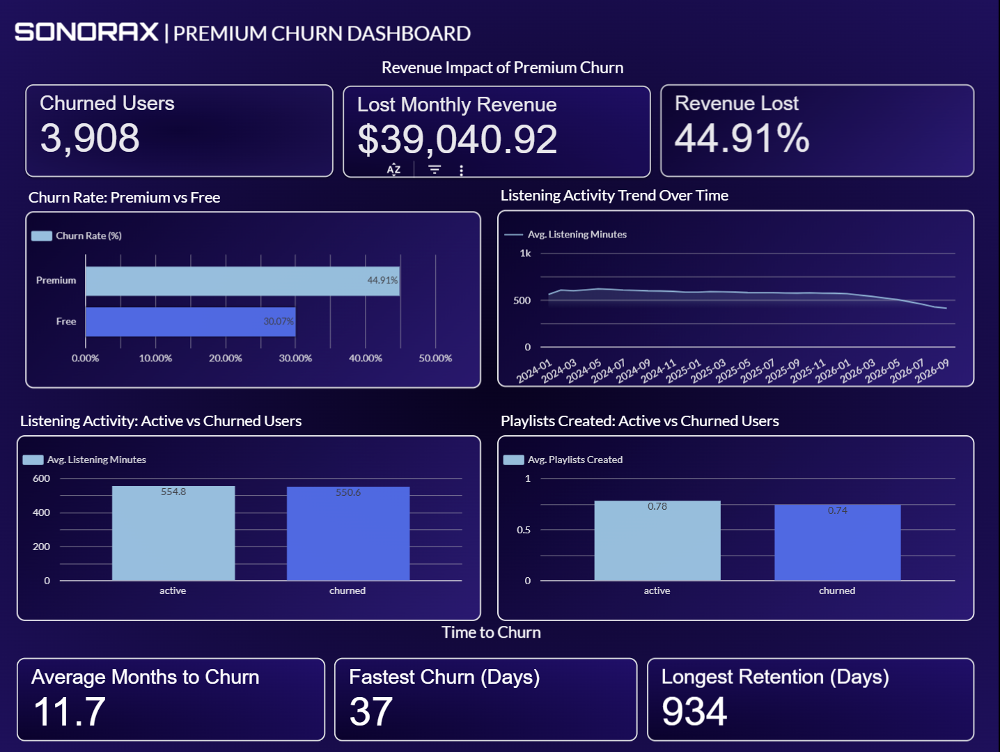
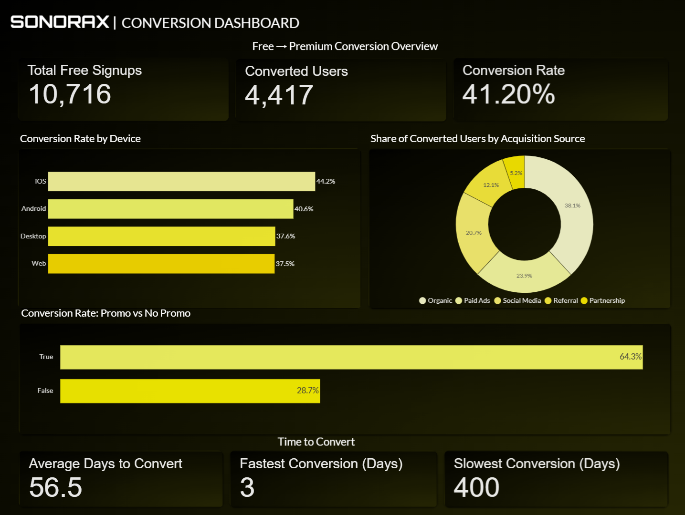
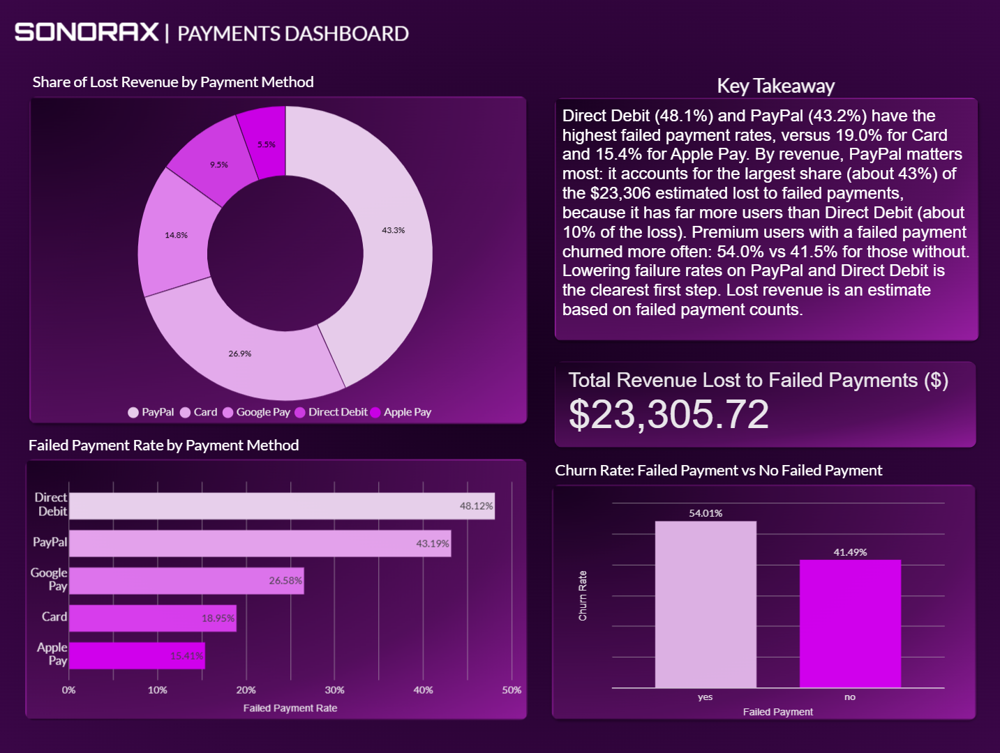
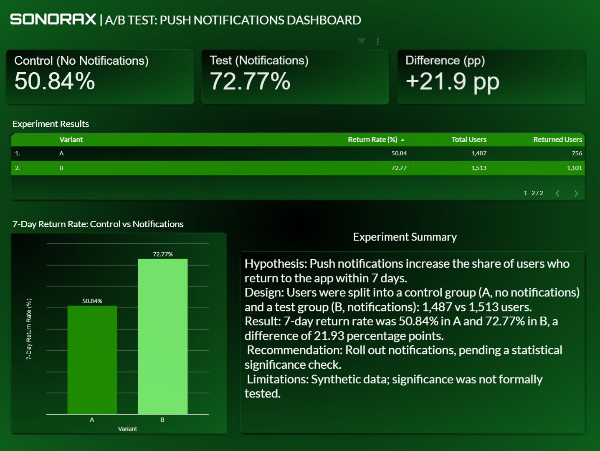
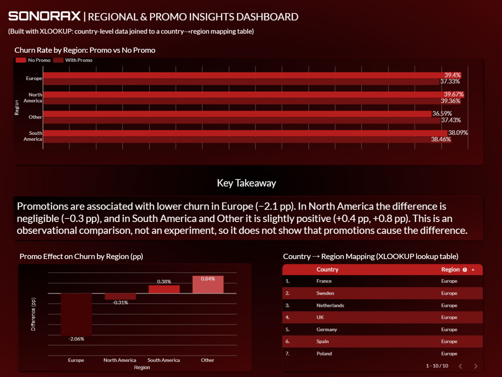
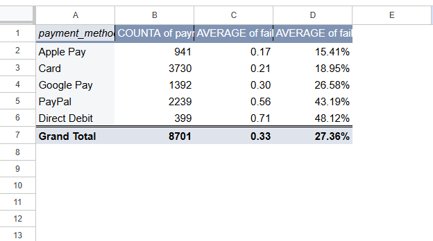
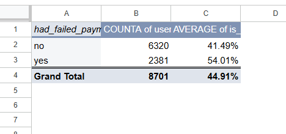
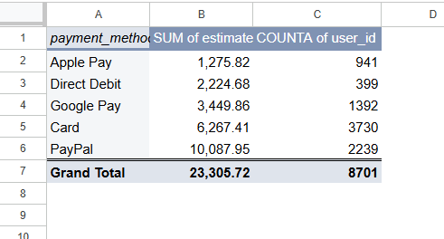
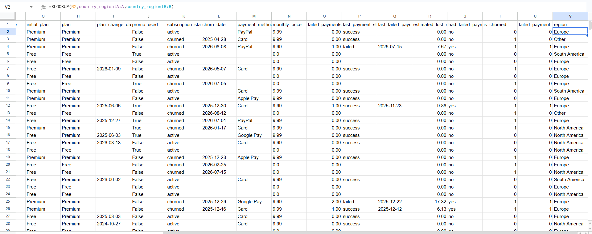
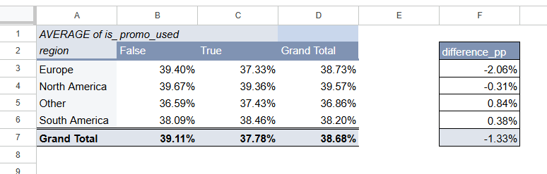

# Sonorax — User & Subscription Analytics

**Author:** Ewelina Silina  
**Project Type:** Data Analytics Portfolio Project   
**Tools:** PostgreSQL (SQL) · pgAdmin 4 ·  Google Sheets (pivot tables, XLOOKUP) · Looker Studio · GitHub  
**Dataset:** Synthetic dataset generated with the assistance of AI: 15,000 users, about 215,000 monthly listening records and 6,000 A/B test assignments (January 2024 – September 2026), covering 10 country categories (7 European countries, USA, Brazil and "Other"). All data is fictional and created exclusively for analytical and portfolio purposes.

📊 **[View Dashboard](https://datastudio.google.com/reporting/b7bdd54a-6ee8-45be-aef0-8f65f45b12c4)**  
📊 **[View Google Sheets Analysis](https://docs.google.com/spreadsheets/d/1i2JDQBkH-AwZcbQ26CAiCuM2XQDCLog0N-pFuiwgNQQ/edit?usp=sharing)**

---
# Project Overview

This project explores user behavior, subscription performance, payment activity, and engagement patterns in Sonorax, a fictional music streaming service.

Using a synthetic dataset of 15,000 users, the analysis investigates customer churn, failed payments, Free-to-Premium conversion and listening activity, and evaluates push notifications (A/B test) and promotions.

The goal is to identify factors associated with Premium subscription cancellations, uncover potential revenue risks, and translate the findings into actionable business recommendations.

The analysis was conducted in PostgreSQL (SQL), cross-checked in Google Sheets, and presented in a 5-page Looker Studio dashboard.

Each analytical topic follows a structured approach:

**Business Problem → Data → Analysis → Insight → Business Recommendation**

---
# Key Findings 

- **Premium Churn:** 44.9% of Premium users have churned (3,908 users), representing approximately $39K in lost monthly recurring revenue (MRR). Users who leave do so about 11.7 months after signing up, on average. 

- **Payment Failures:** Premium users with failed payments churn more often (54.0%) than Premium users without them (41.5%). Direct Debit (48.1%) and PayPal (43.2%) have the highest share of users with a failed payment, vs 19.0% for Card and 15.4% for Apple Pay. The estimated revenue lost to failed payments is $23.3K.

- **Conversion:** 41% of users who started on the Free plan upgraded to Premium (4,417 of 10,716), on average after 56.5 days. iOS users converted most often (44.2%).
  
- **Listening Activity:** Listening time alone does not meaningfully distinguish Premium users who churn from those who stay (550.6 vs 554.8 minutes per month, on average). Across all users, average monthly listening declined gradually from May 2024 to December 2025 (about 8%) and fell faster between January and September 2026 (about 28%).

- **Push Notification Experiment:** In the A/B test, the 7-day return rate was 72.8% with push notifications vs 50.8% without (about 1,500 users per group), suggesting a positive effect on short-term engagement. Statistical significance was not formally tested.

- **Promotions:** Promotions are associated with lower churn in Europe (−2.1 percentage points), but not in other regions, where the difference is negligible or reversed. This is an observational comparison, not an experiment.
  
---

# Business Problem
Premium is the only paid plan in the dataset, so customer retention is directly tied to recurring revenue. 44.9% of Premium subscribers have cancelled, and the reasons are unclear.

The business needs to understand what is associated with cancellations. Do users listen less before they leave? Do failed payments contribute to subscription loss? Which Free users convert to Premium, how fast, and what influences it? Do push notifications bring users back to the app, and are promotions associated with lower churn?

Without evidence, retention budget is spent on assumptions. This project shows where users are lost and which factors are associated with churn, and turns the findings into data-driven recommendations to protect recurring revenue.

---
# Project Objectives

**The analysis answers these questions:**

**1. Churn:** 

- What percentage of Premium users cancel their subscriptions?   
- How long after signing up do Premium users typically cancel?    
- What is the estimated financial impact of Premium cancellations?

**2. Payments:** 

- Which payment methods have the highest failure rates?   
- Is there an association between failed payments and subscription cancellations?   
- What is the estimated revenue impact of payment failures?

**3. Conversion:** 

- What percentage of Free users convert to Premium?   
- How long does it take users to upgrade to Premium?   
- How do device type, acquisition channel, and use of promotions relate to conversion rates?
  
**4. Engagement:**

- Do users who churn listen less or create fewer playlists than users who stay?   
- How does average listening change over time?  

**5. A/B Testing:** 

- Do push notifications increase the percentage of users who return to the app within 7 days?   

**6. Promotions:**

- Are users who used a promotion less likely to churn?    
- Does the relationship between promotion use and churn vary across regions?
---

# Dataset Description

**Data Source**

The project uses a synthetic dataset generated programmatically (Python/NumPy) with AI assistance (Claude), with realistic relationships built in on purpose. It simulates user behavior, subscriptions, payments, and engagement in a fictional music streaming service, Sonorax. Signups cover January 2024 – May 2026, and listening activity runs until September 2026.   
The data does not represent real customers or business transactions. All findings demonstrate the analytical workflow using simulated data.

**Dataset Structure**

|Table | Rows | Content |
|------|------|---------|
| `users` | 15,000 | One row per user: country, age, device, acquisition source, plan, signup / conversion / churn dates, promo flag, payment method and failed payments |
| `listening_activity` | 215,324 | One row per user per month: listening minutes, sessions, songs played, playlists created, skips |
| `ab_test_assignments` | 6,000 | One row per user per test: two A/B tests with variant and 4-week pre/post metrics. This project analyzes the push notifications test (3,000 users) |
| `country_region` | 10 | Google Sheets lookup table: maps each country to a region (Europe, North America, South America, Other), used with `XLOOKUP` |

Full column descriptions: [DATA_DICTIONARY.md](DATA_DICTIONARY.md)

**Simplifications**

- Payments and the conversion date are columns in `users` (no transaction table).
- There is a single Premium price ($9.99) and currency (USD).
- Each user converts at most once.
---

# Tools & Technologies

| Tool | Purpose |
|---|---|
| **PostgreSQL + pgAdmin 4** | SQL querying with joins, aggregations and conditional logic. |
| **Google Sheets** | Cross-checking SQL results, pivot tables, and `XLOOKUP` for data enrichment (adding a region to every user). |
| **Looker Studio** | 5-page dashboard with KPI scorecards, charts, and written takeaways. |
| **GitHub** | Project documentation and storage of SQL code and data. |

---

# Analysis & Methodology 

1. **Defined the business questions** and the KPIs for each of them (see Key Performance Indicators below).   
2. **Loaded the data into PostgreSQL** and analyzed it with SQL, one file per query, grouped by topic: churn (`01`), payments (`02`), conversion (`03`), engagement (`04`) and the A/B test (`05`).   
3. **Cross-checked the results in Google Sheets.** Pivot tables reproduce the key payment results from SQL: failed payment rate by payment method, churn with and without a failed payment, and lost revenue.   
4. **Extended the analysis in Google Sheets.** A lookup table and `XLOOKUP` add the region to every user, and a pivot table compares churn with and without promotions by region.   
5. **Validated the numbers.** Totals were reconciled between SQL, Sheets and the dashboard (for example, total lost revenue from failed payments is $23,305.72 in all three). This also caught a data-import problem: Google Sheets silently turned some decimals into dates, which was fixed by re-importing with automatic conversion switched off.   
6. **Built a 5-page dashboard in Looker Studio:** Premium Churn (including listening activity), Conversion, Payments, A/B Test and Regional & Promo Insights. Each page has titled charts and KPI scorecards, and pages 3–5 include a written takeaway.   
7. **Analyzed the A/B test:** compared the 7-day return rate of the control and test groups and wrote a short experiment readout (hypothesis, design, result, recommendation, limitations). No formal significance test was run.

---

# Key Performance Indicators (KPIs)

| KPI | Definition | Business Purpose |
| --- | --- | --- |
| Churn Rate | Percentage of users with `subscription_status = 'churned'` within a given group. | Measures subscriber loss. |
| Time to Churn | Difference between `churn_date` and `signup_date` (measured from signup, not from the upgrade to Premium). | Identifies when users leave in their lifecycle. |
| Lost Monthly Revenue (Churn) | Number of churned Premium users × monthly subscription price ($9.99). Covers one month, not customer lifetime value. | Estimates monthly recurring revenue lost due to cancellations. |
| Failed Payment Rate | Percentage of Premium users with at least one failed payment, grouped by payment method. | Identifies payment methods with higher failure rates. |
| Estimated Lost Revenue (Payments) | Failed payments × monthly price × recovery factor (0.6–1.0, reflecting that part of the failed payments is retried successfully). | Assesses the estimated financial impact of payment failures. |
| Conversion Rate | Percentage of users who started on the Free plan and upgraded to Premium. | Measures Free-to-Premium conversion performance. |
| Time to Convert | Difference between `plan_change_date` and `signup_date`. | Measures how long users take to upgrade. |
| Average Monthly Listening | Average `listening_minutes` per user per month (also `playlists_created`). | Compares engagement between groups and over time. |
| 7-Day Return Rate | Percentage of test users who returned to the app within 7 days (`returned_7d`). | Measures short-term user engagement in the A/B test. |
| Promotional Churn Difference (pp) | Churn rate of users who used a promotion minus churn rate of users who did not, in percentage points, by region. | Evaluates the relationship between promotions and churn (observational). |

---

# Key Findings & Insights

### 1. Premium Churn and Revenue Impact

- **44.91% of Premium users churned** (3,908 users), compared with 30.07% of Free users who left the service.
- Premium cancellations represent an estimated **$39,041 in lost monthly recurring revenue (MRR)**: 3,908 users × $9.99.
- On average, Premium users cancelled **11.7 months after signing up**; the range was 37 to 934 days.

### 2. Payment Failures and Churn

- Premium users with at least one failed payment had a **54.0% churn rate**, compared with 41.5% among Premium users without a failed payment.
- The share of users with a failed payment varied significantly across payment methods:

| Payment Method | Users with a Failed Payment | Share of Estimated Lost Revenue |
| --- | ---: | ---: |
| Direct Debit | 48.1% | 9.5% |
| PayPal | 43.2% | 43.3% |
| Google Pay | 26.6% | 14.8% |
| Card | 19.0% | 26.9% |
| Apple Pay | 15.4% | 5.5% |

- Estimated revenue lost to failed payments amounts to **$23,305.72**.
- Direct Debit has the highest failure rate, but PayPal accounts for the largest share of lost revenue because it has far more users (2,239 vs. 399).

### 3. User Engagement and Listening Activity

- Average monthly listening time was nearly identical for churned and active Premium users: **550.6 vs. 554.8 minutes**.
- Playlist creation was also similar: **0.74 vs. 0.78 playlists per user per month**.
- Across all users, average monthly listening stayed relatively stable through 2025, then declined by approximately 28% between January and September 2026 (from 566 to 410 minutes).

**Insight:** Listening time and playlist creation alone do not meaningfully distinguish churned users from active subscribers.

### 4. Free-to-Premium Conversion

- **41.2% of users who started on the Free plan converted to Premium** (4,417 of 10,716).
- Average time to conversion was 56.5 days.
- Conversion rates varied by device:

| Device | Conversion Rate |
| --- | ---: |
| iOS | 44.2% |
| Android | 40.6% |
| Desktop | 37.6% |
| Web | 37.5% |

- Users who used a promotion converted at 64.3%, compared with 28.7% for users who did not. This is an observed association, not evidence of a causal effect: the promotion flag is recorded at user level, so it is unknown whether the promotion came before the conversion.

### 5. Push Notifications: A/B Test

- The notification group had a **72.77% 7-day return rate**, compared with 50.84% in the control group.
- This is a difference of **21.93 percentage points**.
- The test included 3,000 users: 1,513 in the notification group and 1,487 in the control group.

**Insight:** The experiment showed a positive difference in short-term engagement following push notifications. Statistical significance was not formally tested.

### 6. Promotions and Regional Churn

Churn rate with a promotion minus churn rate without one, by region (all users, Free and Premium):

| Region | Churn Rate Difference |
| --- | ---: |
| Europe | −2.06 pp |
| North America | −0.31 pp |
| South America | +0.38 pp |
| Other | +0.84 pp |

- Europe is the only region with a clear difference: churn was 37.33% among users who used a promotion and 39.40% among those who did not.
- In North America the difference is negligible. In South America and Other, churn was slightly higher among users who used a promotion.

**Insight:** The relationship between promotions and churn varies by region. These observational results do not establish a causal promotional effect.

---

# Business Recommendations

### 1. Reduce Payment-Related Churn
Prioritize payment recovery with automated payment retries, reminder notifications, and fallback payment methods. Start with PayPal, which accounts for the largest share of estimated lost revenue, and Direct Debit, which has the highest failure rate. Contact users promptly after a failed payment, as these users churn more often.

### 2. Strengthen First-Year Retention
Focus retention efforts on the first year after signup, as Premium users who cancel do so about 11.7 months after signing up on average. Introduce onboarding and retention campaigns during this period, and monitor payment problems and changes in activity to identify subscribers at risk.

### 3. Validate and Expand Push Notifications
Consider rolling out push notifications more broadly, following a statistical significance test to confirm that the observed increase in the 7-day return rate is reliable. If validated, use targeted notifications to encourage users to return to the platform.

### 4. Improve Churn Detection
Do not rely on listening time alone as an early-warning indicator. Combine payment-related signals with changes in individual user activity over time to identify potential churn more effectively.

### 5. Optimize Promotional Campaigns
Evaluate promotions through controlled experiments before reallocating marketing budgets. Start with Europe, where users who used a promotion churned less (an observed difference, not a proven effect).

### 6. Prioritize Mobile Conversion
Prioritize mobile users (iOS and Android) in conversion campaigns, as they convert best. Investigate why Web and Desktop users convert less often.

---

# Dashboard Preview 

The dashboard has 5 pages, one per topic. Pages 3–5 include a written takeaway.

### Page 1: Premium Churn


Churn rate of Premium vs Free users, lost monthly revenue, time to churn, listening activity and playlist creation of active vs churned users, and the monthly listening trend.

### Page 2: Conversion


Free-to-Premium conversion overview, time to convert, conversion by device, share of converted users by acquisition source, and conversion with and without a promotion.

### Page 3: Payments


Failed payment rate and share of estimated lost revenue by payment method, and churn for users with and without a failed payment.

### Page 4: A/B Test, Push Notifications


7-day return rate of the control and test groups, group sizes, and the experiment summary (hypothesis, design, result, recommendation, limitations).

### Page 5: Regional & Promo Insights


Churn with and without a promotion by region, the difference in percentage points, and the country-to-region lookup table used with `XLOOKUP`.

---

# Google Sheets Analysis

The payment results from SQL were cross-checked with pivot tables in Google Sheets, and the analysis was extended with `XLOOKUP`.

**[View the Google Sheets analysis](https://docs.google.com/spreadsheets/d/1i2JDQBkH-AwZcbQ26CAiCuM2XQDCLog0N-pFuiwgNQQ/edit?usp=sharing)**

### Failed payment rate by payment method


Number of users, average failed payments and share of users with a failed payment, by payment method. The results match the SQL query (for example Direct Debit 48.1%, PayPal 43.2%).

### Churn with and without a failed payment


Churn rate of Premium users with a failed payment (54.0%) vs without (41.5%), the same as in SQL.

### Estimated lost revenue by payment method


Estimated revenue lost to failed payments by payment method. The total of $23,305.72 is identical in SQL, Sheets and the dashboard.

### Adding a region with XLOOKUP


The region of each user is added from the `country_region` lookup table with `=XLOOKUP(country, country_region!A:A, country_region!B:B)`.

### Churn with and without a promotion, by region


Pivot table of churn rate by region and promotion use, with the difference in percentage points. These results feed page 5 of the dashboard (observational, not an experiment).

---

# Limitations & Future Improvements

**Limitations**

- **Synthetic data.** The dataset was generated with AI assistance and contains relationships built in on purpose, so the project shows the analytical workflow, not real customer behavior.
- **A/B test.** No formal statistical significance test was run. The conclusion rests on the size of the difference (21.93 percentage points) and the sample (about 1,500 users per group).
- **Promotions** (conversion and churn by region) are associations, not proof of cause and effect. The promotion flag is recorded at user level, without a date.
- **Payments.** Payment data is stored as columns in `users`, without transaction history, so lost revenue from failed payments is an estimate.
- **Churn revenue** covers one month of lost subscription fees, not customer lifetime value.
- **Single price and currency.** There are no plan tiers (Individual, Duo, Family).
- **Churn analysis** covers the whole period, without cohorts. Time to churn is measured from signup.
- **Dashboard.** The dashboard is static and has no filters.
- Further data notes, for example on independently generated date columns, are in [DATA_DICTIONARY.md](DATA_DICTIONARY.md).

**Future improvements**

- Run a formal significance test for the A/B test (two-proportion z-test) and report a confidence interval.
- Add cohort analysis and measure the change in each user's engagement (first vs last months of activity).
- Build an interactive dashboard with filters (plan, region, device) on the full `users` table.
- Repeat the analysis on a real public dataset.

---

# Repository Structure 

```
sonorax_premium_churn/
├── README.md
├── DATA_DICTIONARY.md                 # column descriptions and data notes
├── data/
│   ├── ab_test_assignments.csv
│   ├── listening_activity.csv
│   ├── listening_activity_sample.csv
│   ├── users.csv                      # full data (large, no preview on GitHub)
│   └── users_sample.csv               # sample, for quick preview
├── sql/                               # one file per query, numbered by topic
│   ├── 01.01–01.05_premium_churn.sql  # churn rate, engagement before churn, time to churn, lost revenue
│   ├── 02.01–02.03_payments.sql       # failed payments and their impact
│   ├── 03.01–03.05_conversion.sql     # Free -> Premium conversion
│   ├── 04.01–04.04_active.sql         # listening activity and engagement
│   └── 05_ab_test_notifications.sql   # A/B test of push notifications
└── images/                            # dashboard and Google Sheets screenshots
```
